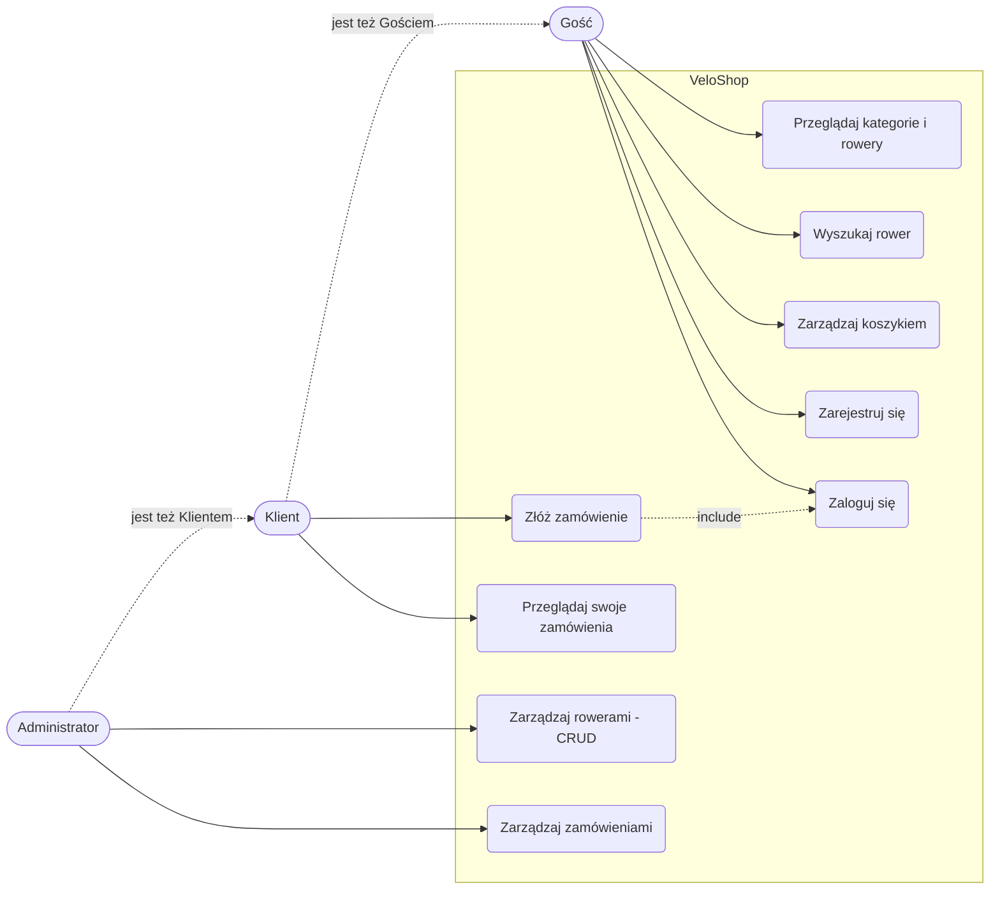
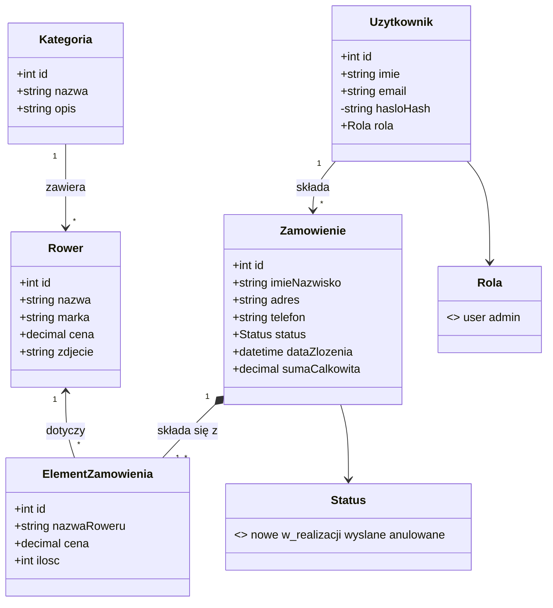
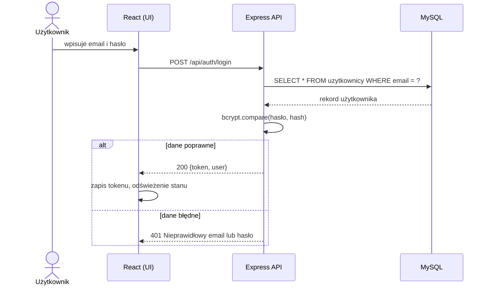
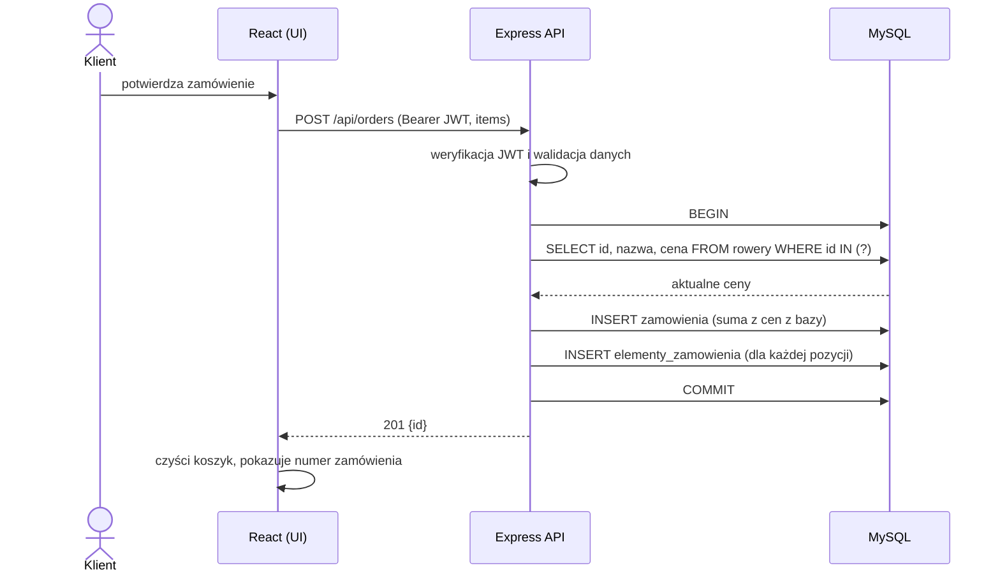
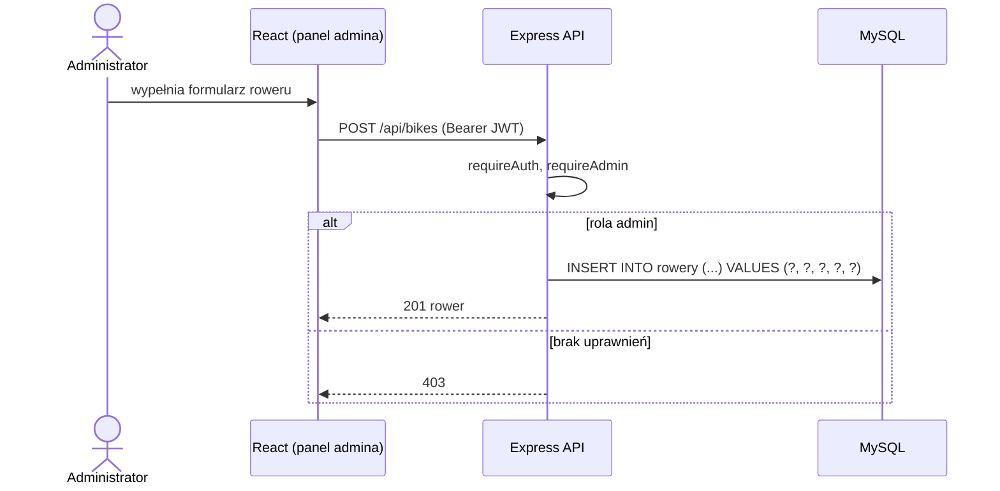

# 2. Specyfikacja wymagań oprogramowania (SRS)

## 2.1 Wprowadzenie
**Produkt:** VeloShop, aplikacja webowa sklepu rowerowego. **Dokument:** SRS wersja 1.0.
**Użytkownicy:** Gość (niezalogowany), Klient (zalogowany), Administrator.

## 2.2 Wymagania funkcjonalne
| ID | Wymaganie | Priorytet | Aktor |
|---|---|---|---|
| F1 | System wyświetla listę kategorii rowerów | wysoki | Gość |
| F2 | System wyświetla rowery, z filtrem kategorii i wyszukiwarką po nazwie/marce | wysoki | Gość |
| F3 | Użytkownik zarządza koszykiem (dodaj, zmień ilość, usuń, wyczyść); koszyk przetrwa odświeżenie strony | wysoki | Gość |
| F4 | Gość może założyć konto (imię, email, hasło min. 8 znaków) | wysoki | Gość |
| F5 | Użytkownik loguje się emailem i hasłem; sesja oparta na tokenie JWT | wysoki | Gość |
| F6 | Zalogowany klient składa zamówienie (imię i nazwisko, adres, telefon) | wysoki | Klient |
| F7 | Klient przegląda historię własnych zamówień i ich statusy | średni | Klient |
| F8 | Administrator dodaje, edytuje i usuwa rowery | wysoki | Admin |
| F9 | Administrator przegląda wszystkie zamówienia i zmienia ich status | średni | Admin |
| F10 | System waliduje dane wejściowe i zwraca czytelne komunikaty błędów | wysoki | wszyscy |

## 2.3 Wymagania niefunkcjonalne
| ID | Kategoria | Wymaganie |
|---|---|---|
| NF1 | Bezpieczeństwo | Hasła przechowywane jako hash bcrypt; zapytania SQL parametryzowane (odporność na SQL Injection) |
| NF2 | Bezpieczeństwo | Operacje administracyjne dostępne tylko z tokenem roli `admin`; nagłówki bezpieczeństwa (helmet); limit prób logowania |
| NF3 | Integralność | Cena zamówienia liczona po stronie serwera na podstawie cen z bazy; zamówienie zapisywane w transakcji |
| NF4 | Wydajność | Lista rowerów obsługuje min. 100 żądań/s przy 50 równoległych połączeniach, bez błędów (test autocannon) |
| NF5 | Użyteczność | Interfejs responsywny (desktop, tablet, telefon), język polski |
| NF6 | Dostępność | Endpoint `/api/health` do monitoringu; automatyczne wdrożenie po zielonym CI |
| NF7 | Utrzymanie | Pokrycie kodu back-endu testami min. 80% instrukcji; dokumentacja API w standardzie OpenAPI |
| NF8 | Przenośność | Uruchomienie jedną komendą (`docker compose up`) |

## 2.4 Przypadki użycia

### Diagram przypadków użycia

### Scenariusze (wybrane)
**UC6 Złóż zamówienie**
- *Aktor:* Klient. *Warunek wstępny:* niepusty koszyk, użytkownik zalogowany.
- *Przebieg główny:* 1) Klient przechodzi do zamówienia. 2) Wypełnia dane wysyłki. 3) System waliduje dane. 4) System pobiera ceny z bazy, liczy sumę i zapisuje zamówienie w transakcji. 5) System czyści koszyk i pokazuje numer zamówienia.
- *Przebiegi alternatywne:* 2a) Niezalogowany użytkownik zostaje przekierowany do logowania. 3a) Dane niepoprawne, system pokazuje komunikat i nie zapisuje zamówienia. 4a) Rower został usunięty z oferty, system zwraca błąd 400.

**UC8 Zarządzaj rowerami**
- *Aktor:* Administrator. *Warunek wstępny:* zalogowany z rolą `admin`.
- *Przebieg:* Admin dodaje/edytuje rower w formularzu lub usuwa go z tabeli. 
- *Alternatywny:* usunięcie roweru występującego w zamówieniach jest blokowane (409) z komunikatem.

**UC5 Zaloguj się**
- *Przebieg:* podanie emaila i hasła, system weryfikuje hash, zwraca token JWT ważny 2 godziny.
- *Alternatywny:* błędne dane, komunikat 401 (ten sam dla złego emaila i hasła).

## 2.5 Diagram klas (model dziedziny)

## 2.6 Diagramy sekwencji

### Logowanie

### Składanie zamówienia

### Dodanie roweru przez administratora

