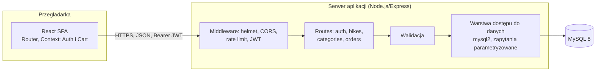
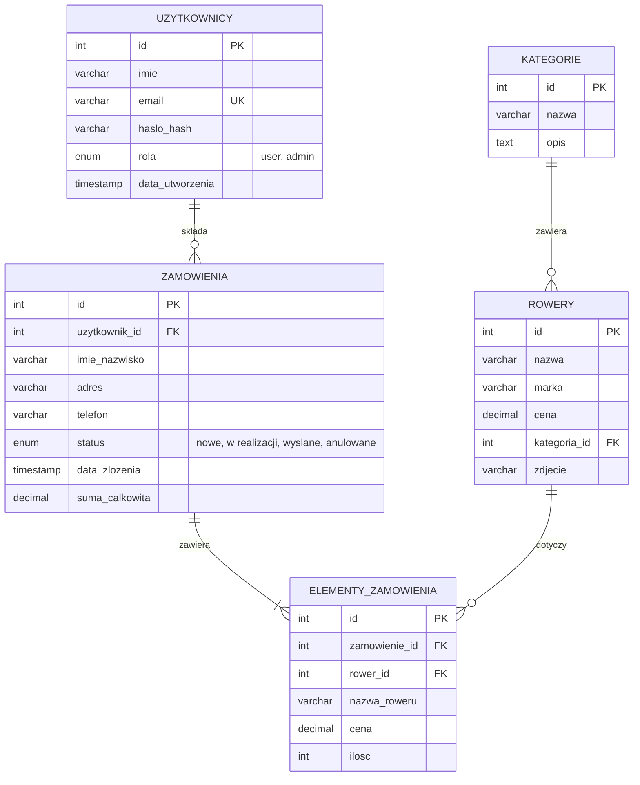

# 3. Projekt systemu

## 3.1 Architektura
Architektura trójwarstwowa. W produkcji Express serwuje także zbudowany front-end, więc cała aplikacja to jedna usługa + baza.



| Warstwa | Odpowiedzialność | Katalog |
|---|---|---|
| Prezentacji | Widoki, routing, stan koszyka i sesji | `frontend/src` |
| Logiki biznesowej | Autoryzacja, walidacja, liczenie sum, transakcje | `backend/src/routes`, `middleware`, `validators.js` |
| Danych | Schemat, zapytania CRUD | `backend/db`, `backend/src/db.js` |

Decyzje projektowe:
- Token JWT (ważność 2 h) w nagłówku `Authorization`, role `user` i `admin` sprawdzane w middleware.
- Ceny w zamówieniu zawsze z bazy; kopia nazwy i ceny roweru w `elementy_zamowienia` zachowuje historię mimo zmian oferty.
- Koszyk po stronie klienta (localStorage), bo nie wymaga konta; konto wymagane dopiero przy zamówieniu.

## 3.2 Projekt interfejsu użytkownika (makiety)
Makiety low-fidelity głównych widoków. Układ i kolorystyka (granat `#1a2a4f`, czerwień `#e63946`) pochodzą z poprzedniego projektu. Do oddania można je odtworzyć w Figmie wg poniższych szkiców.

**Strona główna**
```
+--------------------------------------------------------------+
| VELOSHOP        Wszystkie rowery | Zaloguj | Załóż konto | Koszyk (0) |
+--------------------------------------------------------------+
|        Znajdź swój idealny rower     [Zobacz wszystkie]      |
|--------------------------------------------------------------|
|  Kategorie                                                   |
|  [Górskie] [Turystyczne] [Szosowe] [Gravelowe] [Elektr.] [Dz.]|
+--------------------------------------------------------------+
```
**Lista rowerów**
```
| Szukaj po nazwie lub marce: [__________________]             |
| +--------+ +--------+ +--------+ +--------+                  |
| | foto   | | foto   | | foto   | | foto   |                  |
| | Nazwa  | | Nazwa  | | Nazwa  | | Nazwa  |                  |
| | Marka  | | Marka  | | Marka  | | Marka  |                  |
| | 3999zł | | 2899zł | | 5499zł | | 3699zł |                  |
| |[Dodaj] | |[Dodaj] | |[Dodaj] | |[Dodaj] |                  |
| +--------+ +--------+ +--------+ +--------+                  |
```
**Koszyk i zamówienie**
```
| Rower        Cena     Ilość   Razem    |   Dane do wysyłki      |
| Trek FX 3    3499 zł  [ 2 ]   6998 zł [Usuń] | Imię: [_______]  |
|              Suma:            6998 zł  |      Adres: [_______]  |
| [Kontynuuj] [Wyczyść] [Złóż zamówienie] |      Tel.: [_______]  |
```
**Panel administratora**
```
| [Rowery] [Zamówienia (3)]                                     |
| Formularz: Nazwa | Marka | Cena | Kategoria | Zdjęcie [Dodaj]  |
| ID | Nazwa      | Marka | Cena     | [Edytuj] [Usuń]          |
| Zamówienie #5 - Jan K. - 6998 zł - Status: [nowe v]           |
```

## 3.3 Model bazy danych (ERD)


### Dokumentacja tabel
Pełny skrypt: `backend/db/schema.sql`, dane przykładowe (6 kategorii, 36 rowerów z poprzedniego projektu): `backend/db/seed.sql`.

| Tabela | Opis | Klucze i ograniczenia |
|---|---|---|
| `uzytkownicy` | Konta klientów i administratorów | PK `id`; `email` UNIQUE; `rola` ENUM |
| `kategorie` | Kategorie rowerów | PK `id` |
| `rowery` | Oferta sklepu | PK `id`; FK `kategoria_id` -> `kategorie.id` |
| `zamowienia` | Nagłówek zamówienia | PK `id`; FK `uzytkownik_id` -> `uzytkownicy.id`; `status` ENUM |
| `elementy_zamowienia` | Pozycje zamówienia (kopia nazwy i ceny z chwili zakupu) | PK `id`; FK `zamowienie_id`, `rower_id` |

Operacje CRUD (wszystkie zapytania parametryzowane `?`):
| Encja | Create | Read | Update | Delete |
|---|---|---|---|---|
| Rower | `POST /api/bikes` | `GET /api/bikes`, `/:id` | `PUT /api/bikes/:id` | `DELETE /api/bikes/:id` |
| Zamówienie | `POST /api/orders` | `GET /api/orders/my`, `GET /api/orders` | `PATCH /api/orders/:id/status` | (brak, zamówień nie usuwamy) |
| Użytkownik | `POST /api/auth/register` | `GET /api/auth/me` | (poza zakresem) | (poza zakresem) |

## 3.4 Projekt API (REST)
Pełna specyfikacja w standardzie OpenAPI 3: **`backend/openapi.yaml`**, po uruchomieniu serwera dostępna interaktywnie pod `/api/docs` (Swagger UI). Można ją też zaimportować do Postmana (Import -> plik YAML).

| Metoda | Ścieżka | Dostęp | Opis | Kody |
|---|---|---|---|---|
| GET | `/api/health` | publiczny | Stan serwera | 200 |
| POST | `/api/auth/register` | publiczny | Rejestracja | 201, 400, 409 |
| POST | `/api/auth/login` | publiczny | Logowanie, zwraca JWT | 200, 400, 401 |
| GET | `/api/auth/me` | zalogowany | Dane bieżącego użytkownika | 200, 401 |
| GET | `/api/categories` | publiczny | Lista kategorii | 200 |
| GET | `/api/bikes?kategoria=&q=` | publiczny | Lista rowerów | 200, 400 |
| GET | `/api/bikes/:id` | publiczny | Szczegóły roweru | 200, 404 |
| POST | `/api/bikes` | admin | Dodanie roweru | 201, 400, 401, 403 |
| PUT | `/api/bikes/:id` | admin | Edycja roweru | 200, 400, 403, 404 |
| DELETE | `/api/bikes/:id` | admin | Usunięcie roweru | 204, 403, 404, 409 |
| POST | `/api/orders` | zalogowany | Złożenie zamówienia | 201, 400, 401 |
| GET | `/api/orders/my` | zalogowany | Własne zamówienia | 200, 401 |
| GET | `/api/orders` | admin | Wszystkie zamówienia | 200, 403 |
| PATCH | `/api/orders/:id/status` | admin | Zmiana statusu | 200, 400, 403, 404 |

Błędy zwracane są jako JSON `{ "error": "komunikat" }`.
