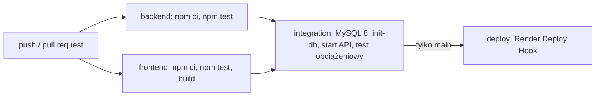

# 6. Dokumentacja deweloperska i wdrożeniowa

## 6.1 Wymagania środowiska
Node.js 20+ (testowane na 22), npm 10+, MySQL 8 lub MariaDB (np. z XAMPP), Git; opcjonalnie Docker.

## 6.2 Konfiguracja środowiska
```bash
git clone <adres-repozytorium> && cd veloshop
cd backend && cp .env.example .env     # uzupełnij hasło do bazy i JWT_SECRET
npm install
npm run init-db                        # baza, tabele, 36 rowerów, konto admina
npm run dev                            # API na :3000
# drugi terminal:
cd frontend && npm install && npm run dev   # UI na :5173
```
Zmienne środowiskowe (`backend/.env`):
| Zmienna | Opis | Domyślnie |
|---|---|---|
| `PORT` | Port API | 3000 |
| `DB_HOST`, `DB_PORT`, `DB_USER`, `DB_PASSWORD`, `DB_NAME` | Połączenie z MySQL | localhost, 3306, root, (puste), sklep_rowerowy |
| `JWT_SECRET` | Sekret podpisu tokenów (**obowiązkowy w produkcji**, serwer nie wystartuje bez niego) | - |
| `JWT_EXPIRES_IN` | Ważność tokenu | 2h |
| `ADMIN_EMAIL`, `ADMIN_PASSWORD` | Konto admina tworzone przez `init-db` | admin@veloshop.pl / Admin123! |
| `DB_SSL` | `true` włącza połączenie SSL z bazą (wymagane u dostawców chmurowych, np. Aiven) | false |
| `DB_SSL_CA` | Opcjonalnie: treść certyfikatu CA dostawcy bazy (zamiast `DB_SSL=true`) | - |
| `AUTH_RATE_LIMIT` | Limit żądań na `/api/auth` na 15 min | 50 |

Nazwa bazy (`DB_NAME`) jest konfigurowalna, np. `veloshop` zamiast domyślnej `sklep_rowerowy` (przydatne, gdy w XAMPP istnieje już baza z poprzedniego projektu).

Zmień hasło admina przed wdrożeniem produkcyjnym.

## 6.3 Struktura kodu
```
backend/src/app.js          konfiguracja Express (middleware, trasy, Swagger, serwowanie frontendu)
backend/src/routes/*.js     auth, bikes (+categories), orders
backend/src/middleware/     auth.js (JWT, role)
backend/src/validators.js   funkcje walidujące
backend/src/db.js           pula połączeń, query(), withTransaction()
frontend/src/pages/         widoki (Home, Bikes, Cart, Checkout, Login, Register, Orders, Admin)
frontend/src/context/       AuthContext, CartContext
frontend/src/cartReducer.js logika koszyka (czysta funkcja)
frontend/src/api.js         klient REST, obsługa tokenu
```
Konwencja dodawania endpointu: trasa w `routes/`, walidacja wejścia na początku handlera, zapytanie wyłącznie z placeholderami `?`, test w `backend/tests`, wpis w `openapi.yaml`.

## 6.4 Procedury testowania
Opisane w `04-testy.md` (rozdz. 4.6): `npm test` w obu katalogach, `npm run test:load` dla wydajności. Przed pull requestem wszystkie testy muszą być zielone.

## 6.5 Workflow Git
Gałąź `main` jest chroniona (wdrażana). Zmiany w gałęziach `feature/...` przez pull request; CI musi przejść, zanim zmiana trafi do `main`. Commity w stylu: `feat:`, `fix:`, `test:`, `docs:`.

## 6.6 CI/CD (GitHub Actions, `.github/workflows/ci.yml`)

- Job `deploy` działa wyłącznie po pushu na `main` i tylko gdy wszystkie wcześniejsze joby są zielone.
- Wymagany sekret repozytorium: `RENDER_DEPLOY_HOOK` (bez niego krok wdrożenia jest pomijany).

## 6.7 Wdrożenie
1. Baza MySQL u dostawcy zewnętrznego. Render oferuje w darmowym planie tylko Postgres, więc MySQL bierzemy z Aiven (darmowy plan: 1 CPU, 1 GB RAM, 1 GB dysku, bez karty; usługa może być wyłączona po dłuższej nieaktywności). Zanotuj host, port, użytkownika i hasło z panelu Aiven i ustaw `DB_SSL=true`.
2. Render: New -> Web Service -> repozytorium GitHub, środowisko **Docker** (używa `Dockerfile` z głównego katalogu).
3. W ustawieniach usługi dodaj zmienne z tabeli 6.2 (zwłaszcza `DB_*`, `JWT_SECRET`, `ADMIN_PASSWORD`).
4. Pierwszy start wykona `init-db` (tworzy tabele, dane i admina, jeśli ich brak) i uruchomi serwer.
5. Skopiuj *Deploy Hook* do sekretu `RENDER_DEPLOY_HOOK` w GitHub, aby kolejne wdrożenia były automatyczne.
6. Alternatywa/awaryjnie: `docker compose up --build` na dowolnej maszynie.

Weryfikacja po wdrożeniu: `GET /api/health` zwraca `{"status":"ok"}`, strona główna pokazuje kategorie, `/api/docs` pokazuje Swaggera.

## 6.8 Monitorowanie i obsługa błędów
- `GET /api/health` podpięty pod zewnętrzny monitoring (np. UptimeRobot, interwał 5 min, powiadomienie e-mail).
- Błędy serwera (500) są logowane na standardowe wyjście i dostępne w logach Render; klient dostaje ogólny komunikat bez szczegółów.
- Typowe problemy: `ECONNREFUSED` (baza niedostępna, sprawdź `DB_*`), `Brak JWT_SECRET` (uzupełnij zmienną), 401 po czasie (token wygasł, zaloguj się ponownie), 429 (limit prób logowania).
- Rollback: w panelu Render wybierz poprzednie wdrożenie ("Rollback").

## 6.9 Rozwój w przyszłości
Odzyskiwanie hasła, płatności online, stany magazynowe, paginacja listy rowerów, upload zdjęć przez panel admina.
